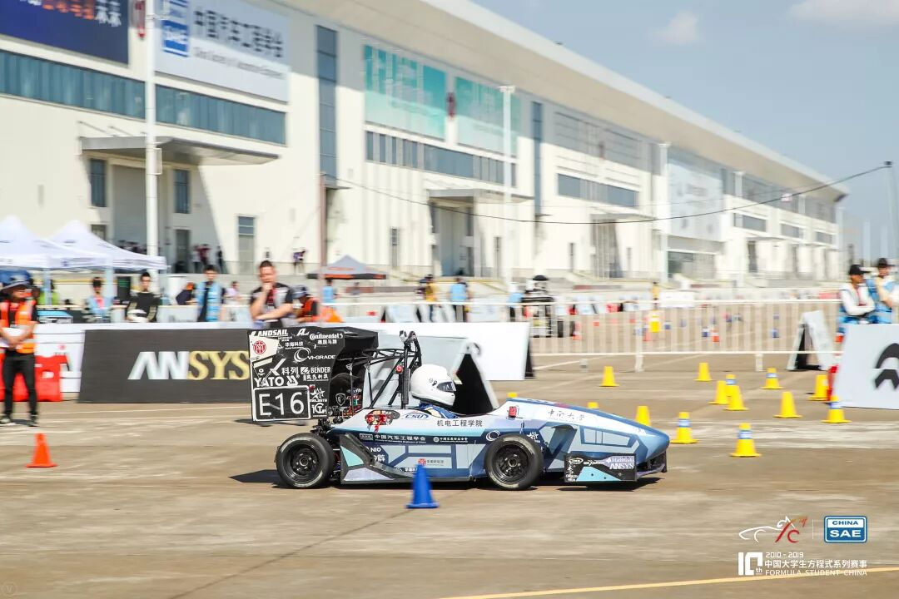
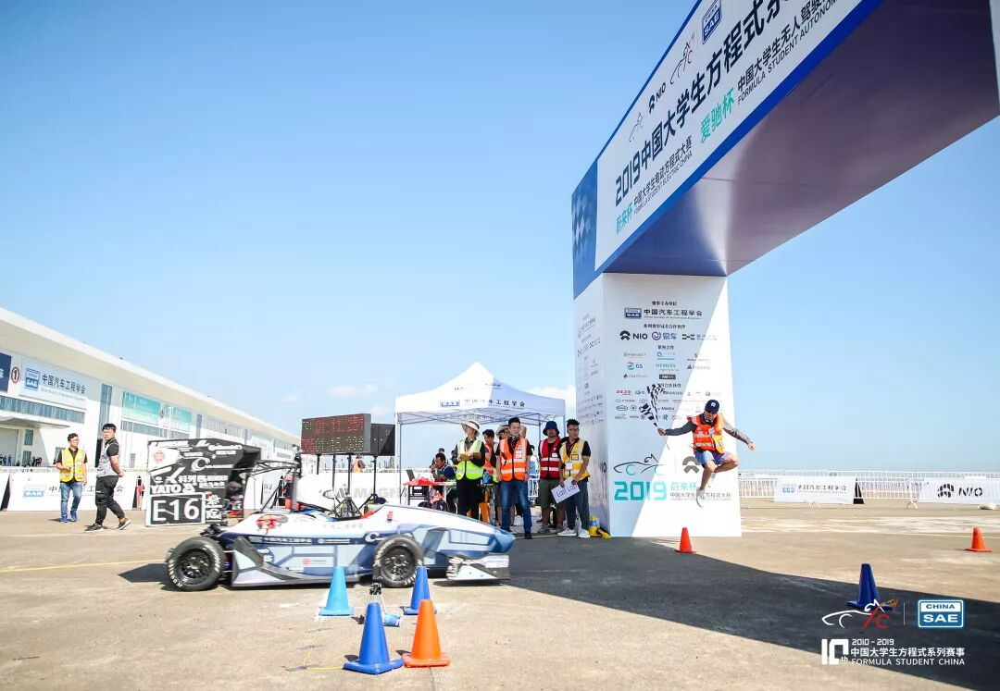
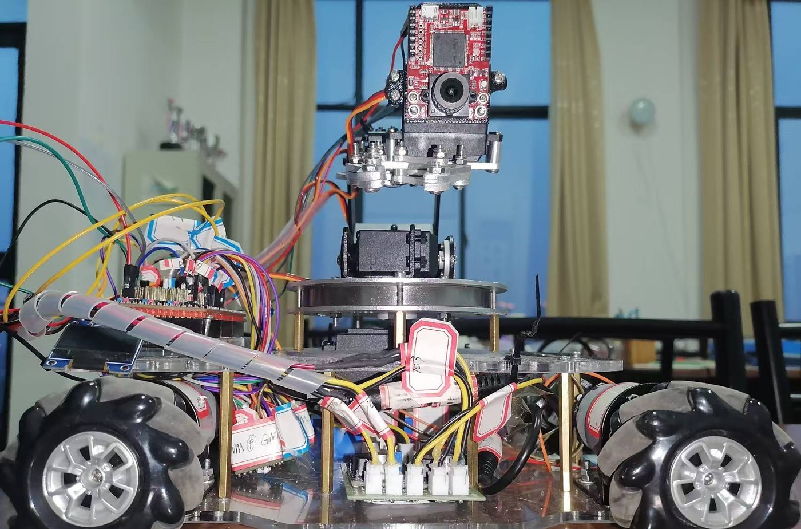

I am a Ph.D. student in Software Engineering at [National University of Defense Technology](https://www.nudt.edu.cn/), Changsha, China.

## About Me

I came to robotics through building electric racing cars. As an undergraduate in Vehicle Engineering at Central South University, I joined the university's Formula Student team, and I served as assistant technical director to co-operate with other teamates to build an electric racing car from scratch each year; in 2019 the team won the **First Prize at the NIO Cup China Electric Formula Student Competition (FSEC)** in Zhuhai. That is where I first built a comprehensive engineering system and learned how to work effectively with others.

I then moved from vehicles to autonomous robotics and was formally trained in research. During my M.S. and now Ph.D. at NUDT, my work has kept returning to the same underlying question: **how should a robot act safely and efficiently when operating in the open world?** My published work treats the plan as something that must be revised online as sensing arrives; my more recent work asks how such plans can be executed faster by running independent actions in parallel. 

My current direction moves toward embodied systems that can reason, act and stay safe: **embodied intelligence, agentic robots, VLA models, and safe AI systems**.

If you would like the full record — degrees, awards, publications and skills — it is on the [CV page](/cv/).

<TABLE>
<tr>
<td width="50%" align="center" style="vertical-align:top; padding:0 4px 4px 0">
  
  
Central South University's E16 at the 2019 FSEC

</td>
<td width="50%" align="center" style="vertical-align:top; padding:0 0 4px 4px">
  
  
The finish line, 2019 China FSEC, Zhuhai

</td>
</tr>
</TABLE>

  
  
The mecanum-wheel robot I built for the 2021 Engineering Training Competition — Second Prize, Central South University. Built on Arduino: motor control, the pan-tilt vision module and the wiring were all developed from scratch, with the vision module providing the visual feedback for autonomous navigation.

## Beyond the Lab

Outside research I hike, play table tennis and swim — partly because they are the same kind of problem as my work, just with better feedback.

## Selected Publications

**Published**

- **[OCP: An Online Contingent Planning Method for Robot Tasks with Incomplete Knowledge](https://doi.org/10.1007/978-981-97-5675-9_4)**
  *Zhiqun Xiao*, Shuo Yang, Yuanzhou Xue, Shuo Wang, Xinjun Mao.
  In *Advanced Intelligent Computing Technology and Applications (ICIC 2024)*, Lecture Notes in Computer Science, vol. 14879, pp. 39–50. Springer, 2024.
  
  Robot tasks are often specified against an initial state the robot cannot fully observe, and classical planning does not handle the resulting uncertainty. This paper presents an online contingent planning method that interleaves planning and execution: rather than committing to a full offline plan, the robot senses, updates what it believes about the world, and replans as new information arrives. This lets the robot still find a feasible plan when its knowledge of the initial state is incomplete.

  <video src="/images/videos/ocp-demo.mp4" poster="/images/videos/ocp-poster.jpg" controls preload="none" style="width:78%; max-width:660px; border-radius:4px; display:block"></video>
  
OCP running on the TiaGo robot: the plan is revised as observations arrive (Part I), followed by a comparison with CFF and DESPOT in planning and execution time (Part II).

**Unpublished manuscripts**

- **Optimizing Contingent Plans with Parallel Relations and Leveled Plan Graphs**
  *Zhiqun Xiao* (first author), manuscript, 2024.
  
  Contingent plans are trees that branch on observation, but a tree enforces a strictly sequential execution order, so actions that could run together are serialized. This work introduces **POCP**, a parallel optimization approach: rules identify which actions in a branch are independent, a planning graph model turns each action sequence into a *leveled plan graph* whose actions can be executed level by level, and an algorithm assembles these graphs into a new tree structure. Evaluated on three robot domains covering the main parallelizable cases — one robot multitasking, multiple robots working in parallel, and multiple robots collaborating on a shared task — POCP cuts task execution time by about **15%** on a single robot, up to **41%** on average with two TiaGo robots, and **12.5%–28%** in the collaborative box-pushing domain.
   See the [detailed description](/publication/2024-07-02-paper-title-number-2) and the demonstration videos below.

## Demonstration Videos

End-to-end execution of the optimized contingent plans on a **TiaGo** mobile manipulation robot, built with ROS and simulated in Gazebo. The left panel shows the action stream dispatched by the planner and the right panel the robot executing it in the coffee-serving environment.

<TABLE>
<tr>
<td width="50%" align="center"><video src="/images/videos/cocg-demo.mp4" poster="/images/videos/cocg-poster.jpg" controls preload="none" width="100%"></video></td>
<td width="50%" align="center"><video src="/images/videos/cff-baseline-demo.mp4" poster="/images/videos/cff-baseline-poster.jpg" controls preload="none" width="100%"></video></td>
</tr>
<tr>
<td align="center"><b>POCP: leveled plan graph execution</b> Actions grouped into levels are carried out in parallel.</td>
<td align="center"><b>Baseline: sequential CFF plan tree</b> The same task executed action by action.</td>
</tr>
</TABLE>

